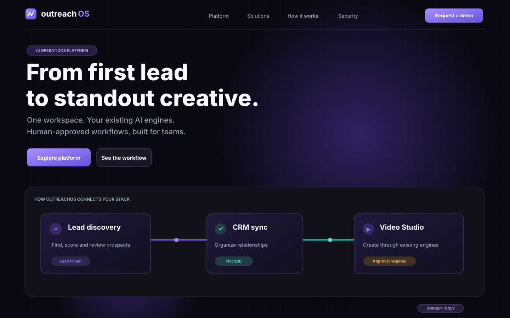

# OutreachOS — UI Research & Frontend Control Plane

Design research and the starting blueprint for **OutreachOS**, a GDPR-aware B2B SaaS frontend and API gateway.

> **Project status:** research and design phase. This repository is **not** a working Next.js application yet. Do not confuse it with the existing production backend engines or the earlier `outreachos.zip` codebase.

## Mission

Build a premium, high-conversion public landing page and a fast, accessible SaaS dashboard. Integrate **existing** services over validated server-side adapters:

- Video Engine: Remotion / Seedance / Veo 3.1 (runs externally)
- AI Lead Finder and scoring signal (runs externally)
- CRM: PostgreSQL + NocoDB (runs externally)

Do **not** recreate video rendering, scrapers, CRM databases, or backend domain engines in this repository.

## Start here

1. **[Visual research gallery + 4 original design previews](docs/VISUAL-RESEARCH.md)**
2. [UI reference collection — 15 examples](docs/UI-REFERENCES.md)
3. [Proposed design system](docs/DESIGN-SYSTEM.md)
4. [Architecture and GDPR guardrails](docs/ARCHITECTURE.md)
5. **[Codex visual handoff](docs/CODEX-VISUAL-HANDOFF.md)**
6. [Codex / Claude task 01](docs/CODEX-TASK-01.md)
7. [Progress checklist](STATUS.md)

## Original concept gallery

> All visuals below are original **design concepts**, not third-party website screenshots or evidence of running software.

| Dashboard | Video Studio | Approvals |
|---|---|---|
| [View dashboard design](research/visuals/02-dashboard-concept.svg) | [View Video Studio](research/visuals/03-video-studio-concept.svg) | [View Approval Center](research/visuals/04-approval-center-concept.svg) |

## Next step

When the original app code is available, compare its `docs/CONVENTIONS.md`, navigation routes, and existing integrations to these notes. Do not overwrite working backend logic or claim that the frontend is integrated until real API contracts are confirmed.

## Research policy

Reference websites are **inspiration**, not assets to copy verbatim. Check each component's license and usage conditions before inclusion. Do not reuse third-party screenshots, trademarks, or customer testimonials as OutreachOS marketing material without permission. Any displayed reviews or customer outcomes must be authentic and authorized.
