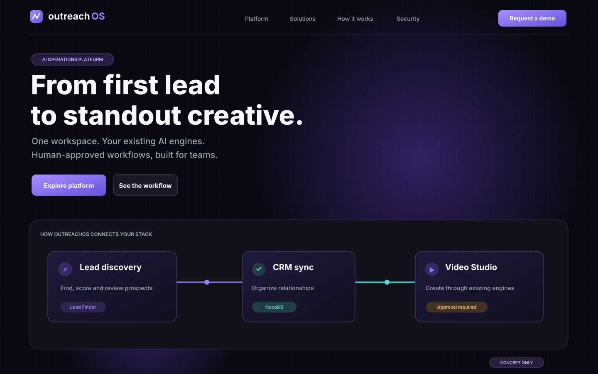
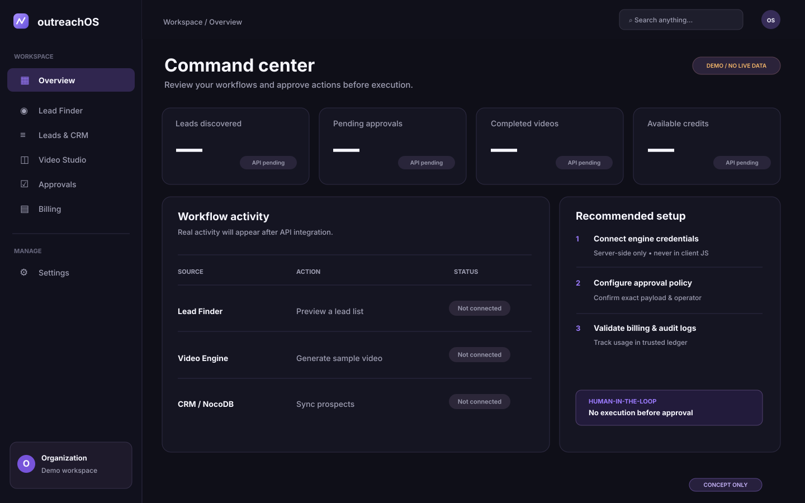
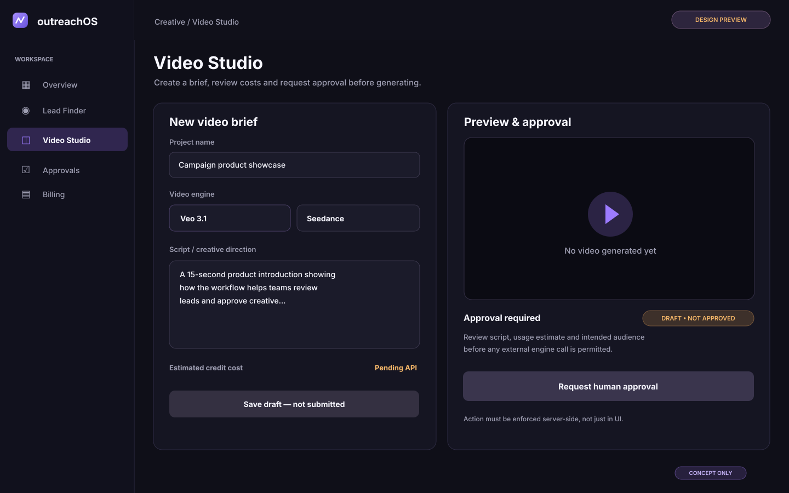
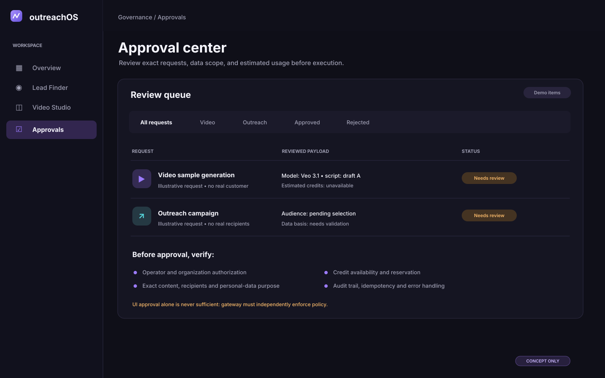

# OutreachOS — Visual Research & Design Handoff

**Date:** 2026-11-11  
**Status:** Completed reference review + **original illustrative mockups**.  
**Important:** Original concept previews below are **not screenshots of deployed OutreachOS** and contain **demonstration-only, non-real data**. Third-party reference images are not copied into this public repository.

## 1. Four original visual concept previews

These files are original editable SVG design explorations. Open each to inspect the layout directly in GitHub.

### Landing page — first impression

[Open full image](../research/visuals/01-landing-concept.svg)

**Why:** Clear enterprise headline, a purposeful hero and workflow visual connecting Lead Finder → NocoDB CRM → Video Studio. This communicates the integration story without implying the existing engines are rebuilt here.

**Take into implementation:** hero hierarchy, centered feature workflow, CTA contrast, dark surfaces, restrained purple glow.  
**Avoid:** auto-playing heavy 3D scenes, made-up ROI results, fabricated customer quotes.

### Dashboard — fast overview

[Open full image](../research/visuals/02-dashboard-concept.svg)

**Why:** Persistent navigation, clear separation of setup tasks, operational overview and incomplete data states.  
**Take into implementation:** shadcn/ui app shell, compact cards, connection statuses, true empty states and keyboard navigation.  
**Avoid:** placeholder numbers masquerading as genuine usage, unnecessary animation.

### Video Studio — brief and preview

[Open full image](../research/visuals/03-video-studio-concept.svg)

**Why:** Script and model choices separated from preview and approval, with the external engine explicitly left untouched.  
**Take into implementation:** draft → estimate → human review → server-approved execution → status/video link.  
**Avoid:** triggering billable generation from input change; placing engine secrets in client bundles.

### Approval Center — human-in-the-loop

[Open full image](../research/visuals/04-approval-center-concept.svg)

**Why:** Review user, tenant, exact request payload and credit implications before any external side effect.  
**Take into implementation:** approval queue, clear statuses, details and audit trail; server-side policy enforcement.  
**Avoid:** treating click-only UI approval as sufficient; running outreach without legal-basis checks.

## 2. External visual references — browse live demos

These are **source links only**; do not redistribute their proprietary screenshots as local image files without verifying permission.

### Marketing and brand direction

| Inspiration | Direct link | What to evaluate |
|---|---|---|
| Linear | https://linear.app/ | Premium dark presentation, product screenshots, hierarchy, whitespace |
| Raycast | https://www.raycast.com/ | Feature storytelling and interaction density |
| Vercel | https://vercel.com/ | Enterprise landing-page hierarchy, trust sections |
| Framer | https://www.framer.com/ | Motion-led marketing site composition |
| Aceternity | https://ui.aceternity.com/components | Bento, hero and scroll components |
| Axon template | https://www.fullstackevolved.com/templates/axon/ | Dark AI-focused visual concept |

### Dashboard and product UX

| Inspiration | Direct link | What to evaluate |
|---|---|---|
| Attio | https://attio.com/ | CRM data views, filtering, contact records |
| shadcn/ui dashboard block | https://ui.shadcn.com/blocks/dashboard | Information layout + table architecture |
| shadcn/ui sidebar blocks | https://ui.shadcn.com/blocks/sidebar | Collapsible, mobile navigation |
| Runway | https://runwayml.com/ | Creative generation flow and preview panels |
| Clientra CRM design | https://dribbble.com/shots/26537016-Clientra-CRM-Dashboard | Clear metrics/card hierarchy; **concept, not actual OutreachOS metrics** |
| Nexora futuristic CRM | https://dribbble.com/shots/27160035-Nexora-Futuristic-CRM-Dashboard | Purple-dark dashboards; avoid overusing effects |

### Motion components — see actual demos

| Component | Live demo | Usage in OutreachOS |
|---|---|---|
| Container Scroll | https://ui.aceternity.com/components/container-scroll-animation | Once in product reveal on `/` |
| 3D Marquee | https://ui.aceternity.com/components/3d-marquee | Only authentic/authorized video samples |
| Animated Beam | https://magicui.design/docs/components/animated-beam | Explain lead → CRM → video flow; decorative only |
| Aurora Background | https://ui.aceternity.com/components/aurora-background | Hero backdrop, ensure text contrast |
| Orbiting Circles | https://magicui.design/docs/components/orbiting-circles | Optional integration ecosystem illustration |

## 3. Inspiration-to-feature mapping

| UI area | Strongest inspiration | Functional requirement |
|---|---|---|
| `/` hero | Linear + Raycast | Outcome headline, real CTAs, responsive |
| `/` workflow | Animated Beam | Display only; no API calls triggered by animation |
| `/` demos | Container Scroll + 3D Marquee | Real owned/consented samples, lazy load |
| `/app` overview | shadcn dashboard | Real or empty states, not fake analytics |
| `/app/leads` | Attio | Filters, select, tenant-aware CRM API |
| `/app/studio` | Runway | Draft → quote → approval → job tracking |
| `/app/approvals` | Original review concept | Explicit exact-payload approval and audit |
| `/app/billing` | shadcn data tables | Stripe payments + trustworthy credit ledger |

## 4. Animation specification

### A. Hero reveal

- On initial page load: stagger headline and CTA opacity/translate within 350–600ms.
- Decorative gradient moves slowly if motion is allowed.
- Reduced motion: static layout with no visual penalty.

### B. Container scroll product reveal

- Desktop only: rotate/scale screenshot gently as the user scrolls.
- Mobile: replace 3D perspective with static image and concise content.
- Never block page scrolling or reading.

### C. Animated Beam integration story

- A static accessible text sequence must explain the flow even when animation is disabled.
- One loop can illuminate **Lead Finder → CRM → Video Studio**.
- Approval requirement is visibly explained; flowing graphics must not imply automatic unauthorized outreach.

### D. Dashboard interaction

- 120–180ms lightweight transitions only for drawer, popover or sidebar.
- No infinite pulse on data tables.
- Keyboard focus should remain visible and not jump after state changes.

## 5. Research completion checklist

- [x] Source links and UI rationale collected.
- [x] Four **original** annotated-by-description design previews created.
- [x] Visual direction and component mapping established.
- [x] Agent handoff prompt and motion specifications written.
- [ ] Browser-captured screenshots of third-party sites stored locally with documented licensing permission; **not in this public repo**.
- [ ] Validate dark-mode contrast, mobile breakpoints and actual API contracts in working app.

## 6. Copyright and privacy

This repository is public. Never upload copyrighted reference-site screenshots or client data without rights or authorization. External links are for study. Any generated product examples must be visibly labeled as demos, not real production results. No website/API passwords, video credentials or CRM secrets may enter the public repository.
